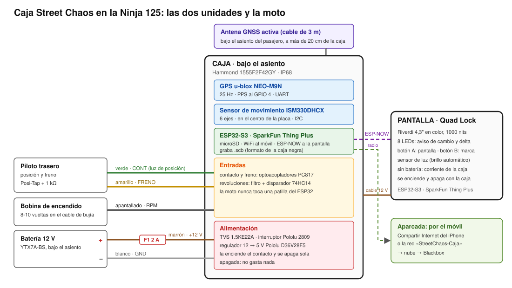

# Caja Street Chaos: prototipo

Proyecto completo para construir la «RaceBox» propia de Street Chaos en la **Kawasaki Ninja 125**. Desarrolla las fases 1, 2 y 4 del plan [docs/caja-diy.md](../../docs/caja-diy.md): qué piezas exactas comprar, cómo se conectan, cómo se sujetan a la moto y el montaje paso a paso.

Estado (2026-11-10): **diseñado, sin comprar ni montar.** El firmware lo escribo yo cuando lleguen las piezas, empezando por el de pruebas de banco (hito H1).

## Qué es

Son dos aparatos:

- **La caja.** Va atornillada o pegada bajo el asiento.
  - Graba en la microSD y en el formato de la caja negra del móvil:
    - GPS a 25 Hz;
    - sensor de movimiento a 100 Hz;
    - freno;
    - revoluciones.
  - Se enciende con el contacto y se apaga sola.
  - Al llegar a casa sube las salidas al Blackbox por WiFi.
  - No tiene batería propia: apagada no gasta nada.
- **La pantalla.** Va en tu soporte Quad Lock, con el amortiguador.
  - Pantalla que se lee a pleno sol, 8 LEDs para el aviso de cambio y el delta, dos botones y sensor de luz.
  - Funciona con batería, recibe los datos de la caja por radio (ESP-NOW) y se carga por USB-C en casa.

## Archivos

| Archivo | Qué tiene |
| --- | --- |
| [piezas.md](piezas.md) | Lista de la compra con referencias exactas, tiendas y precios. Versión ahorro. Herramientas |
| [piezas.csv](piezas.csv) | La misma lista en tabla, para hoja de cálculo |
| [conexiones.md](conexiones.md) | Patillas, circuitos, lista de conexiones para soldar, cable a la moto, pantalla y datos para el firmware |
| [montaje.md](montaje.md) | Paso a paso: pruebas de banco, placa, caja, cable, instalación en la Ninja 125, revoluciones, pantalla, comprobaciones y mantenimiento |
| [esquemas/sistema.svg](esquemas/sistema.svg) | Las dos unidades y la moto |
| [esquemas/caja-electrico.svg](esquemas/caja-electrico.svg) | Circuito eléctrico de la caja |
| [esquemas/placa-base.svg](esquemas/placa-base.svg) | Dónde va cada pieza en la placa, a escala |
| [esquemas/caja-taladros.svg](esquemas/caja-taladros.svg) | Agujeros de la caja y cómo se ancla |
| [esquemas/pantalla.svg](esquemas/pantalla.svg) | Distribución y conexiones de la pantalla |

El firmware irá en `firmware/`.

## Decisiones

Cierran las decisiones pendientes del plan:

| Pendiente | Decidido | Por qué |
| --- | --- | --- |
| GPS | **u-blox NEO-M9N** (SparkFun GPS-17285) con antena activa externa | 25 Hz con GPS, Galileo y GLONASS a la vez: lo de una RaceBox. Tiene la señal PPS y alimenta la antena. La MAX-M10S (10 Hz) queda como versión ahorro |
| Placa | **SparkFun Thing Plus ESP32-S3**, la misma en las dos unidades | Trae la microSD, medidor de batería y conector Qwiic, y tiene existencias. Una sola plataforma para el firmware |
| Sensor de movimiento | **ISM330DHCX** (Adafruit 4502) | De ST, industrial, ±16 g y ±4000 °/s, FIFO de 9 KB |
| Alimentación de la caja | **12 V permanente con fusible + interruptor electrónico** (Pololu 2809): lo enciende el contacto y lo apaga la caja al terminar | Sin batería bajo el asiento, que es donde más calor hace. Puede subir las salidas con la moto apagada. Apagada no gasta nada |
| Dónde va | Bajo el asiento (el del pasajero si cabe), plana; la antena bajo plástico, a más de 20 cm | Cerca del centro de la moto y lejos del calor. Se comprueba con una maqueta de cartón (montaje, paso 0.2) |
| Pantalla | **Sharp Memory 2,7"** (Adafruit 4694) + 8 LEDs | Se lee perfecta a pleno sol. De noche no se ve, pero los LEDs sí |
| Enlace | **ESP-NOW** (radio) y la pantalla con su batería | Ni un cable hasta el manillar. Se quita y se carga como el móvil |
| Soporte de la pantalla | **Adaptador Quad Lock Original** sobre una chapa atornillada a la caja | Usa tu soporte y tu amortiguador |
| Revoluciones | **Pinza de cable enrollado** en el cable de bujía | La Ninja 125 tiene bobina con cable, así que no hay que tocar el encendido. El conector de diagnosis (KDS) queda como mejora futura |
| Marchas | Se deducen de la velocidad y las revoluciones | La Ninja 125 no tiene sensor de marcha. Las relaciones de la caja de cambios dan el punto de partida |
| Herramientas | Hay que soldar: soldador, multímetro, crimpadora y pistola de calor | Las placas vienen sin pines y la placa base es soldada. Nada de cables de enchufar dentro de la caja |

## Coste

| Parte | Aprox. |
| --- | --- |
| Caja (fases 1 y 2) | 300 € |
| Material de instalación | 52 € |
| Pantalla (fase 4) | 199 € |
| **Total** | **≈ 550 €** (versión ahorro ≈ 410 €) |
| Herramientas, si faltan | ≈ 150 € |

Detalle y versión ahorro en [piezas.md](piezas.md#5-resumen-y-versión-ahorro).

## Orden de trabajo

| Hito | Tú | Yo | Dónde |
| --- | --- | --- | --- |
| H1 · Banco | Comprar; probar cada placa con los ejemplos | Firmware de banco: lee GPS e IMU y graba en bruto | [montaje 0-1](montaje.md#0-antes-de-empezar) |
| H2 · Formato | Probar a pie o en coche | `.scb` en el firmware, importar `.scb` en el Blackbox, pruebas | |
| H3 · Caja y primera salida | Placa base, caja, cable, instalación | Comparar con el iPhone en el Blackbox | [montaje 2-5](montaje.md#2-la-placa-base) |
| H4 · Autonomía | Probar arranque y parada con la llave | Contacto, interruptor, recuperación tras cortes | |
| H5 · WiFi | Vincular en casa | Página de la caja, vinculación, subida sola | |
| H6-H7 · Freno, revoluciones y marchas | Pinza y calibración | Eventos, `FORMAT` 2, marchas, potencia por revoluciones | [montaje 6](montaje.md#6-revoluciones-fase-2) |
| H8-H10 · Pantalla | Montarla y ponerla en el Quad Lock | Firmware de la pantalla, delta, LEDs | [montaje 7](montaje.md#7-unidad-de-pantalla-fase-4) |

## Lo que falta comprobar en tu moto

Lo que no se ha podido confirmar desde fuera y se mira con la moto delante:

1. **El sitio de la caja**: el hueco exacto bajo los asientos. Si no cabe la caja de 160,8 × 90,8 × 62,5 mm, se cambia a una más estrecha.
2. **Los colores** de los cables de posición y freno del piloto trasero: se miden con el multímetro.
3. **Las chispas por vuelta** (probablemente una) y **el ralentí**: se calibran con el cuentarrevoluciones.
4. **Por dónde se llega al cable de bujía**: puede que haya que quitar algún carenado.
5. **El circuito de revoluciones**: valores de partida que puede que haya que ajustar.

## Seguridad

- Fusible a menos de 15 cm de la batería.
- Ningún cable de la moto cortado: solo derivaciones.
- Nada cerca del escape ni de lo que se mueve.
- Después de cada cambio, comprobar las luces y el freno.
- La pantalla, grande y de reojo; nunca se toca en marcha.
- El repo es público: aquí no van claves ni datos de salidas.
