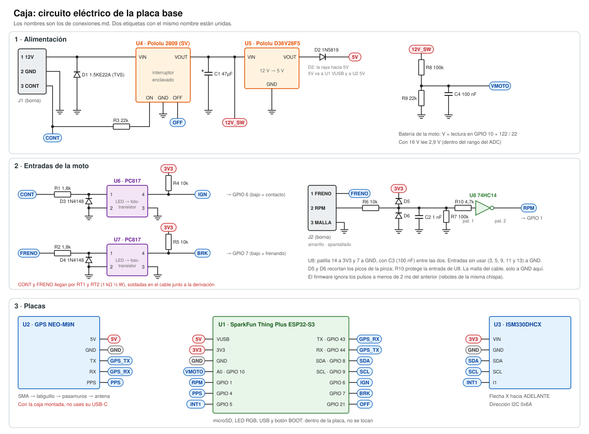
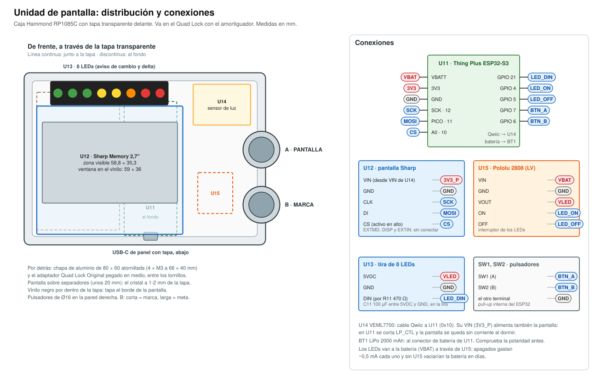

# Conexiones

Cómo va conectado todo, cable a cable. Esta página manda: el firmware usa estas patillas y estos nombres. Las piezas (con sus referencias exactas) están en [piezas.md](piezas.md) y el orden de montaje en [montaje.md](montaje.md).

- [1. Mapa de patillas de la caja](#1-mapa-de-patillas-de-la-caja)
- [2. Alimentación de la caja](#2-alimentación-de-la-caja)
- [3. Entradas de la moto: contacto, freno y revoluciones](#3-entradas-de-la-moto-contacto-freno-y-revoluciones)
- [4. Lista de conexiones de la placa base](#4-lista-de-conexiones-de-la-placa-base)
- [5. Cable de la caja a la moto (Ninja 125)](#5-cable-de-la-caja-a-la-moto-ninja-125)
- [6. Unidad de pantalla](#6-unidad-de-pantalla)
- [7. Datos para el firmware](#7-datos-para-el-firmware)

Esquemas:
- [esquemas/sistema.svg](esquemas/sistema.svg): las dos unidades y la moto;
- [esquemas/caja-electrico.svg](esquemas/caja-electrico.svg): el circuito completo de la caja;
- [esquemas/placa-base.svg](esquemas/placa-base.svg): dónde va cada pieza en la placa;
- [esquemas/caja-taladros.svg](esquemas/caja-taladros.svg): los agujeros de la caja y cómo se ancla;
- [esquemas/pantalla.svg](esquemas/pantalla.svg): la unidad de pantalla.



---

## 1. Mapa de patillas de la caja

Placa **U1 = SparkFun Thing Plus ESP32-S3**. Los números son los GPIO del ESP32-S3.

En la serigrafía de la placa, las patillas digitales llevan su número de GPIO. Otras llevan nombre:
- `TX` (43), `RX` (44), `SDA` (8) y `SCL` (9);
- `A0`-`A5` (10, 14, 15, 16, 17 y 18);
- `SCK` (12), `PICO` (11) y `POCI` (13).

Por orden, el lado corto de patillas (12) es: `SDA`, `SCL`, `1`, `2`, `4`, `5`, `6`, `7`, `21`, `VUSB`, `EN`, `VBATT`. En la placa, `VUSB` y `VBATT` pueden aparecer como `VU` y `VB`.

| GPIO | Patilla de la placa | Va a | Sentido | Nota |
| --- | --- | --- | --- | --- |
| 43 | `TX` | GPS `RX` | sale | UART del GPS |
| 44 | `RX` | GPS `TX` | entra | UART del GPS |
| 4 | `4` | GPS `PPS` | entra | Un pulso por segundo, flanco de subida exacto |
| 5 | `5` | IMU `I1` (INT1) | entra | «Hay datos en la FIFO» |
| 8 | `SDA` | IMU `SDA` | I2C | Resistencias de 2,2 kΩ ya en la placa |
| 9 | `SCL` | IMU `SCL` | I2C | |
| 6 | `6` | Optoacoplador del contacto (U6) | entra | **Nivel bajo = contacto puesto** |
| 7 | `7` | Optoacoplador del freno (U7) | entra | **Nivel bajo = frenando** |
| 1 | `1` | Revoluciones (salida del 74HC14, U8) | entra | Un pulso bajo por chispa |
| 10 | `A0` | Divisor de tensión de la batería de la moto | analógica | ADC1. V moto = V leída × 122 / 22 |
| 21 | `21` | Interruptor de encendido (U4), patilla `OFF` | sale | Un pulso alto de 10 ms apaga toda la caja |
| 14 | `A1` | Botón del manillar (J3-2), por R12 | entra | **Nivel bajo = pulsado.** Pull-up interna; antirrebote en el firmware. Solo se usa con el móvil de pantalla ([docs/caja-movil.md](../../docs/caja-movil.md)) |

Ya usadas dentro de la placa, **no tocar**:
- microSD: GPIO 33, 34, 38, 39, 40 y 47, y 48 para detectar la tarjeta;
- LED RGB: 46;
- LED y botón BOOT: 0;
- aviso del medidor de batería: 35;
- alimentación del Qwiic y la microSD (`3.3V_P`): 45;
- USB: 19 y 20.

> **En la caja, el GPIO 45 siempre en alto y la soldadura `LP_CTL` sin cortar.** El sensor de movimiento depende de las resistencias del I2C que cuelgan de `3.3V_P`, y la microSD también. No se corta en ninguna de las dos placas.

Libres para más adelante: 2 (IMU `I2`), 42, 11, 12, 13, 15, 16, 17 y 18. Las analógicas buenas (ADC1) son solo de la 1 a la 10: la ADC2 no funciona con el WiFi encendido.

---

## 2. Alimentación de la caja

La caja **no lleva batería propia**. Va a la batería de la moto (12 V siempre), con un interruptor electrónico que la enciende el contacto y que apaga la propia caja cuando ha terminado. Apagada no gasta nada (0,01 µA), así que la moto puede pasar meses parada.

```
 Batería + ──[F1 2 A]──(marrón)──► J1-1 «12V» ──┬───────────► U4 VIN    (interruptor Pololu 2809)
                                                │
                                          D1 TVS 1.5KE22A
                                     (raya hacia «12V»)
                                                │
 Batería − ──────────(blanco)────► J1-2 «GND» ──┴── GND común

 U4 VOUT = «12V_SW» ──┬──► U5 VIN    (regulador Pololu D36V28F5)
                      ├──[F2 0,75 A]──► J3-1 «PANT» ══(marrón)══► pantalla (apartado 6)
                      ├── C1 47 µF 50 V ── GND
                      └── R8 100k ──┬── R9 22k ── GND
                                    ├── C4 100 nF ── GND
                                    └──► GPIO 10 (mide la batería de la moto)

 U5 VOUT ──▶|── «5V» ──► U1 VUSB (placa)  y  U2 5V (GPS)
          D2 1N5819

 J3-2 «BOTÓN» ══(verde)══ R12 1k ──┬──► GPIO 14 (pull-up interna; pulsado = bajo)
                                   └── C5 100 nF ── GND
 J3-3 «GND» ══(blanco)══ GND

 Contacto ──(verde)──► J1-3 «CONT» ──┬── R3 22k ───► U4 ON
                                     └── R1 1,8k ──► optoacoplador U6 (apartado 3)

 GPIO 21 ──────────────────────────────────────────► U4 OFF
```

Cómo funciona:

1. **Das el contacto.** La luz de posición recibe 12 V y, a través de R3, la patilla `ON` del interruptor U4 lo enciende. Llegan 12 V al regulador U5, que da 5 V a la placa y al GPS.
2. **Quitas el contacto.** U4 sigue encendido (se queda «enclavado»). La caja ve el contacto quitado por el GPIO 6 y cierra la salida. Si tiene salidas sin pasar, espera al móvil.
3. **La caja se apaga sola.** El firmware da un pulso en el GPIO 21 hacia `OFF` y U4 corta todo. Lo hace solo si el contacto sigue quitado, así `ON` está en bajo y no hay conflicto.
   - Tiempo máximo encendida sin contacto: 15 minutos, aunque no haya terminado de subir.
   - Si la batería de la moto baja de 12,0 V, se apaga en el momento.
4. **Si el firmware se cuelga**, el perro guardián del ESP32 lo reinicia, arranca, ve que no hay contacto y se apaga.

Solo el firmware puede apagar la caja. Por eso esas reglas van en el firmware como protecciones aparte (apartado 7), y en la instalación se comprueba que apagada no gasta nada ([montaje, paso 5.8](montaje.md#58-conectar-y-probar)).

Por qué cada pieza:

| Pieza | Para qué |
| --- | --- |
| **F1** fusible de 2 A, junto a la batería | Si algo se cortocircuita, salta el fusible y no arde el cable. La caja gasta como mucho 0,3 A a 12 V; con la pantalla, unos 0,6 A |
| **F2** fusible rearmable de 0,75 A y **J3** | J3 lleva 3 hilos hasta el manillar:<br>• `PANT` (J3-1): los 12 V del interruptor (`12V_SW`) hacia la pantalla Riverdi (apartado 6). Así la pantalla se enciende y se apaga con la caja, y apagada tampoco gasta nada. Si ese cable hace corto, F2 corta y se rearma solo al quitar el corto;<br>• `BOTÓN` (J3-2): el botón del manillar, si se usa el móvil de pantalla;<br>• `GND` (J3-3): masa |
| **R12 y C5** | Protegen la entrada del botón del manillar: el cable es largo y pasa junto al mazo de la moto. R12 limita la corriente de cualquier pico, y C5 filtra el ruido. El pull-up es el interno del ESP32 |
| **D1** TVS 1.5KE22A | Corta los picos de tensión de la moto. Deja pasar hasta 18,8 V sin hacer nada y recorta a 30,6 V como mucho, por debajo de lo que aguantan U4 (40 V) y U5 (50 V). Si conectas la batería al revés, conduce y salta el fusible |
| **U4** Pololu 2809 (versión SV, 4,5-32 V) | El interruptor. **No uses la versión LV (2808) aquí**: solo aguanta 20 V |
| **C1** 47 µF 50 V | Reserva junto al regulador contra picos de los cables |
| **U5** Pololu D36V28F5 | 12 V → 5 V, hasta 3,2 A (la caja pide unos 0,6 A en el peor momento). Aguanta hasta 50 V y la batería al revés |
| **D2** 1N5819 | Deja pasar los 5 V hacia la placa pero no al revés. **La patilla `VUSB` de la placa es la misma que el USB**: sin este diodo, al enchufar el USB al ordenador, sus 5 V entrarían en el regulador U5. Aun así, **enchufa el USB con la caja apagada**: con la caja encendida hay ~4,8 V en el USB y el ordenador puede no reconocer la placa. **Orden seguro en la mesa:** primero el USB, con la fuente de 12 V quitada, y después la fuente. Con los dos puestos, el USB (5,0 V) alimenta la placa; U5 solo llega a ~4,7 V por D2, así que no entra corriente al ordenador. El USB se puede quitar en cualquier momento. Si la caja se apaga con el USB puesto, la placa sigue encendida por el USB, pero `12V_SW` baja a 0 V |
| **R8, R9, C4** | Divisor de tensión: el ESP32 mide la batería de la moto (para la pantalla ESTADO y avisar si está baja). Con 16 V lee 2,9 V, dentro de su rango |

El GPS (U2) toma los 5 V por su patilla `5V`; tiene su propio regulador a 3,3 V. Así no carga el regulador de la placa, que se queda para el ESP32 y la microSD.

> **Ojo con dos USB:** el puerto USB-C del **GPS** también está unido a su patilla `5V`, sin diodo. Con la caja montada, **no enchufes nada al USB del GPS**. Al de la placa (U1) sí.

---

## 3. Entradas de la moto: contacto, freno y revoluciones

### 3.1 Contacto y freno (dos circuitos iguales)

```
 En la derivación                       │  En la caja
                                        │
 luz de posición ── RT1 1k ½ W ══(verde)══► J1-3 «CONT» ── R1 1,8k ──┬── pat. 1 ▶|── pat. 2 ──┬── GND
                                        │                            │       (LED de U6)       │
                                        │                            └──────────|◀─────────────┘
                                        │                                    D3 1N4148
                                        │
                                        │         3V3 ── R4 10k ──┬──► GPIO 6  (bajo = contacto puesto)
                                        │                         │
                                        │              U6 pat. 4 ─┘          U6 pat. 3 ── GND
```

El freno es igual: RT2 en la derivación (cable amarillo), luego R2, U7, D4 y R5, y va al **GPIO 7**.

- **RT1 y RT2 (1 kΩ ½ W) van en la propia derivación**, soldadas en el cable y cubiertas con termorretráctil: son el «fusible» de esos dos cables. Si el cable verde o el amarillo se pelan y tocan masa bajo el asiento, solo pasan unos 14 mA. Así no salta el fusible de las luces de la moto y la luz de freno sigue funcionando.
- El optoacoplador enciende su LED interior con los 12 V de la moto (unos 4 mA, a través de RT y R) y su transistor pone la patilla del ESP32 a nivel bajo. La moto nunca toca directamente una patilla del ESP32.
- En el `CONT` de la caja llegan unos 7-8 V (RT1 se come una parte). Le sobra para encender U4 por R3.
- **D3/D4**, puestos al revés en paralelo con el LED, lo protegen: el LED solo aguanta 6 V en inverso.
- La moto y la caja comparten la masa (la caja se alimenta de la misma batería), así que la masa de los optoacopladores es la masa común.
- Tiempo de respuesta: unas decenas de microsegundos. Sobra para medir el freno al milisegundo.

### 3.2 Revoluciones (pinza en el cable de bujía)

La Ninja 125 tiene la bobina sujeta al chasis y **un cable de bujía** hasta la pipa. Alrededor de ese cable se enrollan unas vueltas de cable: cada chispa induce ahí un pico de tensión, sin tocar el encendido.

```
                          R6 10k            ┌──▶|── 3V3   (D5 1N4148: recorta por arriba)
 Pinza ═(apantallado)═ J2-2 ──/\/\/\──┬─────┤
 Malla ═══════════════ J2-3 ── GND    │     └──|◀── GND   (D6 1N4148: recorta por abajo)
                                      ├── C2 1 nF ── GND
                                      ├── R7 100k ── GND
                                      └── R10 4,7k ──► 74HC14 (U8) entrada 1A (pat. 1)
                                                       salida 1Y (pat. 2) ─────► GPIO 1

 U8 74HC14: pat. 14 a 3V3, pat. 7 a GND, C3 100 nF entre 14 y 7.
            Entradas sin usar (pat. 3, 5, 9, 11, 13) a GND. Salidas sin usar (4, 6, 8, 10, 12) al aire.
```

- **R6** limita la corriente de los picos y **D5/D6** los recortan más o menos entre −0,7 y 4 V. **R10** protege la entrada del 74HC14 de ese margen que se pasa de su rango.
- **C2** y **R7** filtran el ruido y fijan el nivel en reposo.
- El **74HC14** es un disparador Schmitt: convierte el pico, sucio y con rebotes, en un pulso limpio que el ESP32 cuenta con una interrupción.
- El firmware ignora los pulsos que llegan antes de 2 ms del anterior (rebotes de la misma chispa). A 10.500 rpm, el corte de encendido, hay una chispa cada 5,7 ms.
- **Malla del cable**: solo a GND en la caja. En la punta de la pinza se deja cortada y aislada.
- **Puesta a punto** (esta parte del circuito no está probada en una Ninja 125; puede que haga falta ajustarla):
  - si no cuenta nada, prueba con 2-3 vueltas más o sin C2. Para quitar C2 hay que sacar U1, porque queda debajo;
  - si cuenta pulsos dobles, una vuelta menos o una ventana de rebote más larga en el firmware.

### 3.3 Por qué no la centralita

La Ninja 125 tiene un **conector de diagnosis de 4 vías (KDS)** junto a la centralita. Por él se pueden leer revoluciones, acelerador y temperaturas; hay indicadores de marcha comerciales que lo usan. Es una mejora posible para más adelante: necesita un chip de línea K (L9637) y no está probado con esta centralita. La pinza funciona siempre y da una medida por chispa, más fina.

---

## 4. Lista de conexiones de la placa base

Para soldar. Cada fila es una «red»: todo lo que pone en la fila tiene que quedar unido. Táchalas al soldarlas y **comprueba cada una con el multímetro en modo continuidad** antes de enchufar nada.

Nombres de las piezas:
- **J1, J2, J3:** bornas de tornillo de 3 vías. J3 es la salida al manillar (pantalla o botón).
- **F2:** fusible rearmable de la pantalla.
- **U1:** placa (Thing Plus).
- **U2:** GPS.
- **U3:** IMU.
- **U4:** interruptor Pololu 2809.
- **U5:** regulador D36V28F5.
- **U6, U7:** PC817.
- **U8:** 74HC14.

En los PC817 y en el 74HC14 la patilla 1 lleva un punto o una muesca.

| Red | Une |
| --- | --- |
| `12V` | J1-1 · D1 cátodo (lado de la raya) · U4 `VIN` |
| `GND` | J1-2 · J2-3 · J3-3 · C5 · D1 ánodo · U4 `GND` · U5 `GND` · C1 − · U1 `GND` · U2 `GND` · U3 `GND` · U6 pat. 2 y 3 · U7 pat. 2 y 3 · D3 ánodo · D4 ánodo · D6 ánodo · C2 · C3 · C4 · R7 · R9 · U8 pat. 7, 3, 5, 9, 11, 13 |
| `CONT` | J1-3 · R1 · R3 (RT1 va fuera, en la derivación del cable verde) |
| `ON` | R3 (otro extremo) · U4 `ON` |
| `OPTO_CONT` | R1 (otro extremo) · U6 pat. 1 · D3 cátodo |
| `FRENO` | J2-1 · R2 (RT2 va fuera, en la derivación del cable amarillo) |
| `OPTO_FRENO` | R2 (otro extremo) · U7 pat. 1 · D4 cátodo |
| `12V_SW` | U4 `VOUT` · U5 `VIN` · C1 + · R8 · F2 |
| `PANT` | F2 (otro extremo) · J3-1 |
| `BTN_MAN` | J3-2 · R12 |
| `BTN` | R12 (otro extremo) · C5 · U1 `A1` (GPIO 14) |
| `5V_REG` | U5 `VOUT` · D2 ánodo |
| `5V` | D2 cátodo (lado de la raya) · U1 `VUSB` · U2 `5V` |
| `3V3` | U1 `3V3` · U3 `VIN` · R4 · R5 · U8 pat. 14 · C3 · D5 cátodo |
| `VMOTO` | R8 (otro extremo) · R9 · C4 · U1 `A0` (GPIO 10) |
| `IGN` | U6 pat. 4 · R4 (otro extremo) · U1 `6` |
| `BRK` | U7 pat. 4 · R5 (otro extremo) · U1 `7` |
| `RPM_IN` | J2-2 · R6 |
| `RPM_N` | R6 (otro extremo) · D5 ánodo · D6 cátodo · C2 · R7 · R10 |
| `RPM_S` | R10 (otro extremo) · U8 pat. 1 |
| `RPM` | U8 pat. 2 · U1 `1` |
| `OFF` | U1 `21` · U4 `OFF` |
| `GPS_TX` | U2 `TX` · U1 `RX` (GPIO 44) |
| `GPS_RX` | U2 `RX` · U1 `TX` (GPIO 43) |
| `PPS` | U2 `PPS` · U1 `4` |
| `SDA` | U3 `SDA` · U1 `SDA` (GPIO 8) |
| `SCL` | U3 `SCL` · U1 `SCL` (GPIO 9) |
| `INT1` | U3 `I1` · U1 `5` |

Sin conectar:
- **U4:** `CTRL`, `A` y `B`.
- **U5:** `EN` (lleva su propia resistencia que lo deja encendido) y `PG`. Si U5 tiene dos patillas `GND`, las dos van a `GND`.
- **U2:** `3V3`, `RST`, `SAFE`, `INT`, `SDA`, `SCL`, `CS` y `SCK`, y sus dos Qwiic.
- **U3:** `3Vo`, `DO`, `CS`, `I2` y la fila de arriba (`SCX`, `SDX`…).
- **U1:** su conector Qwiic y su conector de batería.

Comprobaciones con el multímetro antes de enchufar las placas:
- **En continuidad**, entre `12V` y `GND`, entre `5V` y `GND` y entre `3V3` y `GND` **no tiene que pitar**.
  - Un pitido corto al principio es normal: es un condensador cargándose.
  - Si pita seguido, hay un corto: búscalo antes de seguir.
- **En modo diodo**, punta roja en `12V` y negra en `GND`: tiene que marcar «OL». Si marca ~0,6 V, D1 está al revés. La continuidad no lo detecta.
- `GND` con `GND`: pita en todos los puntos de la lista.

---

## 5. Cable de la caja a la moto (Ninja 125)

Tres cables, cada uno por su prensaestopas:
- uno de 4 hilos a la batería y al piloto (manguera 4 × 0,5 mm², colores DIN: marrón, blanco, verde, amarillo);
- uno apantallado para las revoluciones;
- uno de 3 hilos (3 × 0,5 mm², marrón, blanco y verde) hasta el manillar: la pantalla o el botón.

| Borna | Color | Señal | En la moto se conecta a | Cómo |
| --- | --- | --- | --- | --- |
| J1-1 `12V` | marrón | +12 V permanente | **Borne + de la batería**, con el portafusibles F1 (fusible de 2 A) a menos de 15 cm de la batería | Terminal de ojal M5 bajo el tornillo del borne |
| J1-2 `GND` | blanco | Masa | **Borne − de la batería** | Terminal de ojal M5 |
| J1-3 `CONT` | verde | 12 V con el contacto | **Cable de la luz de posición trasera** (el que tiene 12 V en cuanto das el contacto) | Derivación Posi-Tap, sin cortar el cable, con **RT1 (1 kΩ ½ W)** soldada en el verde a 2-3 cm de la derivación |
| J2-1 `FRENO` | amarillo | 12 V al frenar | **Cable de la luz de freno** (12 V solo con una maneta o el pedal) | Derivación Posi-Tap, con **RT2 (1 kΩ ½ W)** soldada en el amarillo junto a la derivación |
| J2-2 `RPM` | vivo del apantallado | Pinza | **8-10 vueltas alrededor del cable de bujía**, a unos 5 cm de la bobina | Enrollado y sujeto con cinta autovulcanizante; la punta, aislada y sin conectar |
| J2-3 `MALLA` | malla del apantallado | Masa del blindaje | Solo en la caja; en la punta de la pinza, cortada y aislada | |
| J3-1 `PANT` | marrón del cable de 3 hilos | +12 V mientras la caja está encendida | **Pantalla Riverdi**, por el conector estanco SP13 (patilla 1). Con el móvil de pantalla, sin conectar y aislado | A lo largo del chasis hasta el manillar, con holgura para girar la dirección |
| J3-2 `BOTÓN` | verde del cable de 3 hilos | A masa al pulsar | **Botón del manillar**, si se usa el móvil de pantalla. Con la Riverdi, aislado | El otro terminal del botón, al blanco |
| J3-3 `GND` | blanco del cable de 3 hilos | Masa | Pantalla (SP13, patilla 2) o botón | |

**Colores de la moto: compruébalos con el multímetro** (paso a paso en [montaje.md](montaje.md#5-instalación-en-la-ninja-125)). En otras Kawasaki el freno es azul, la posición es roja y la masa negra con raya amarilla, pero no está confirmado para la Ninja 125 de 2019 en adelante.

El catálogo de recambios da un piloto de bombilla de dos filamentos (21/5 W): el de 5 W es la posición y el de 21 W el freno. Si el tuyo es de LED, se hace igual:
- los cables suelen ser más finos: elige la Posi-Tap de su talla;
- con un multímetro digital puede verse alguna tensión «fantasma» de pocos voltios con la luz apagada.

**Si tu llave tiene posición P** (luz de estacionamiento), comprueba si en P se enciende la luz de posición. Si se enciende, la caja no se apagaría nunca en P: no aparques en P, o toma el contacto de un cable que solo tenga 12 V en ON (por ejemplo, la alimentación del interruptor de la luz de freno).

Datos de la moto:
- **Batería:** YTX7A-BS, 12 V y 6,3 Ah, bajo el asiento.
- **Bujía:** NGK LMAR8G.
- **Bobina:** sujeta al chasis, con cable hasta una pipa larga.
- **Corte de encendido:** 10.500 rpm.
- **No tiene sensor de marcha:** la marcha se deduce de la velocidad y las revoluciones (apartado 7).

---

## 6. Unidad de pantalla



La unidad lleva estas piezas:
- **U11**: placa **SparkFun Thing Plus ESP32-S3**, igual que la de la caja;
- **U12**: pantalla **Riverdi RVT43HLBFWN00**, 4,3", IPS y 1000 cd/m², con un chip gráfico propio (BT817) que dibuja él solo; la placa solo le manda órdenes por SPI;
- la **Break Out Board 20** de Riverdi y su cable plano, que unen la pantalla con la placa.

Se alimenta **de la caja**, por un cable de 2 hilos: se enciende y se apaga con ella, y no lleva batería.

### 6.1 Alimentación

```
 Caja J3-1 «PANT» ══(marrón)══ SP13-1 ──┬────────────► U16 VIN   (regulador Pololu D24V10F5)
                                        ├── D11 TVS 1.5KE22A (raya hacia PANT) ── GND
                                        └── C12 47 µF 50 V ── GND
 Caja J3-3 «GND»  ══(blanco)══ SP13-2 ──── GND

 U16 VOUT = «5V_P» ──┬──► RiBUS 17 y 18 (BLVDD: la luz de la pantalla)
                     ├──► U13 5VDC (tira de LEDs) · C11 100 µF ── GND
                     ├──► U17 pat. 14 (VCC) · C13 100 nF ── GND
                     └──▶|──► U11 VUSB
                       D12 1N5819

 U11 3V3 ──► RiBUS 1 (VDD: la electrónica de la pantalla)
```

- **D11 y C12** hacen lo mismo que D1 y C1 en la caja: recortan los picos que entren por el cable. Si el cable se conecta al revés, D11 conduce y F2 corta en la caja.
- **U16** da 1 A. Lo que gasta la unidad:
  - la luz de la pantalla, hasta 268 mA;
  - la placa, unos 250 mA;
  - los LEDs, limitados a la mitad de brillo, unos 250 mA.
- **D12** hace lo mismo que D2 en la caja: se puede enchufar el USB de la placa para programarla sin que sus 5 V entren en U16. La regla es la misma: primero el USB, con la unidad sin corriente, y después la corriente.
- **Solo con el USB** se alimentan U11 y la electrónica de la pantalla (3,3 V), así que el BT817 contesta. Pero no se encienden la luz de la pantalla, ni los LEDs, ni U17: van a `5V_P`, que solo da U16 con los 12 V. Para ver algo en la mesa, primero el USB y después la fuente de 12 V en el SP13.
- **U17** pasa la señal de los LEDs de 3,3 V a 5 V. Con 5 V de alimentación, los LEDs no dan por buena una señal de 3,3 V.
- La placa no lleva batería: su conector de batería queda libre.
- **La soldadura `LP_CTL` no se corta.** El sensor de luz queda alimentado mientras la unidad tiene corriente.

### 6.2 Patillas

| GPIO | Patilla de U11 | Va a | Nota |
| --- | --- | --- | --- |
| 12 | `SCK` | RiBUS 3 `SPI_SCLK` | SPI |
| 11 | `PICO` | RiBUS 5 `MOSI` | |
| 13 | `POCI` | RiBUS 4 `MISO` | El BT817 contesta: hace falta para leerlo |
| 10 | `A0` | RiBUS 6 `CS` | **Activo en bajo** |
| 5 | `5` | RiBUS 8 `RST/PD` | Activo en bajo: en bajo, la pantalla queda apagada y reiniciada |
| 4 | `4` | RiBUS 7 `INT` | Entra; activo en bajo, con pull-up interna |
| 21 | `21` | U17 1A (pat. 2) → 1Y (pat. 3) → R11 470 Ω → U13 `DIN` | Datos de los LEDs, pasados a 5 V |
| 7 | `7` | Botón A (SW1) a GND | PANTALLA: cambia de pantalla. Pull-up interna |
| 6 | `6` | Botón B (SW2) a GND | MARCA: corta = marca; larga = meta. Pull-up interna |
| 8, 9 | Qwiic | Sensor de luz VEML7700 (U14) | Cable Qwiic; dirección 0x10 |

### 6.3 Redes, para soldar

Las patillas de la Break Out Board 20 siguen el orden del RiBUS (1 a 20). Compruébalo con su serigrafía antes de soldar.

| Red | Une |
| --- | --- |
| `PANT_IN` | SP13-1 · D11 cátodo (lado de la raya) · C12 + · U16 `VIN` |
| `GND` | SP13-2 · D11 ánodo · C12 − · U16 `GND` · U11 `GND` · RiBUS 2, 19 y 20 · U13 `GND` · C11 − · C13 · U17 pat. 7, 1 (1OE) y 5, 9, 12 (entradas sin usar) · SW1 · SW2 |
| `5V_P` | U16 `VOUT` · D12 ánodo · RiBUS 17 y 18 · U13 `5VDC` · C11 + · U17 pat. 14 y 4, 10, 13 (los OE sin usar) · C13 |
| `VUSB` | D12 cátodo (lado de la raya) · U11 `VUSB` |
| `3V3` | U11 `3V3` · RiBUS 1 |
| `SCK` | U11 `SCK` (12) · RiBUS 3 |
| `MOSI` | U11 `PICO` (11) · RiBUS 5 |
| `MISO` | U11 `POCI` (13) · RiBUS 4 |
| `CS` | U11 `A0` (10) · RiBUS 6 |
| `PD` | U11 `5` · RiBUS 8 |
| `INT` | U11 `4` · RiBUS 7 |
| `LED_3V3` | U11 `21` · U17 pat. 2 (1A) |
| `LED_5V` | U17 pat. 3 (1Y) · R11 |
| `DIN` | R11 (otro extremo) · U13 `DIN` |
| `BTN_A` | U11 `7` · SW1 |
| `BTN_B` | U11 `6` · SW2 |

Sin conectar:
- **RiBUS:** 9 a 16.
- **U16:** `EN` (se queda encendido) y `PG`.
- **U13:** `DOUT`.
- **U11:** el conector de batería.

Notas:
- **La luz de la pantalla** la regula el propio BT817 por SPI, sin patilla aparte. Con el sensor de luz: al 100 % a pleno sol y baja de noche.
- **Al quitar el contacto**, la caja puede seguir encendida hasta 15 minutos esperando al móvil, y la pantalla con ella. La pantalla se queda a oscuras (luz a 0, LEDs apagados y el BT817 dormido) en dos casos:
  - en cuanto la caja le dice que no hay contacto;
  - si pasa 3 s sin oír a la caja. Esto ocurre, por ejemplo, cuando la caja se conecta al Compartir Internet del iPhone y cambia de canal.
  Vuelve en cuanto llegan mensajes con el contacto puesto.
- **Vinculación:** la pantalla solo atiende a su caja. Se vinculan una vez desde la pestaña TALLER de la página de la caja (montaje, paso 7.6).
- **Conector SP13:** patilla 1, marrón, +12 V; patilla 2, blanco, masa. Igual en los dos lados. El verde (botón del manillar) no se usa con la Riverdi: queda cortado y aislado en el manillar.

---

## 7. Datos para el firmware

**Prototipo simple (el primero que se monta; decidido el 2026-11-12):**
- Es la misma placa base con menos piezas:
  - **lleva** la alimentación (J1, D1, C1, U4, U5, D2, R3, R8, R9 y C4), el contacto (U6, R1, R4 y D3), U1, el GPS y el sensor;
  - **no lleva** el freno (U7, R2, R5 y D4), las revoluciones (U8, R6, R7, R10, D5, D6, C2, C3 y J2) ni el manillar (F2, J3, R12 y C5).
- Los GPIO 7, 1 y 14 quedan al aire: pull-up interna en los tres, o no leerlos. En esta versión, la PRUEBA DE LA CAJA no da FALLA por FRENO, REVOLUCIONES ni BOTÓN. La versión se elige en la configuración: con las piezas puestas no se distingue.
- Las salidas se bajan **solo por la WiFi de la caja**. No hay subida por el Compartir Internet ni vinculación.
  - Red «StreetChaos-Caja» con una contraseña propia de cada caja, que nunca va al repo.
  - Página en `http://192.168.4.1`: la lista de salidas nuevas (fecha, duración y km), BAJAR (un solo archivo con todas las nuevas) y APAGAR.
- La WiFi está encendida:
  - con la moto parada y sin grabar;
  - al quitar el contacto, 10 minutos; después, el pulso de `OFF`, con las protecciones de siempre (15 minutos como mucho, 12,0 V);
  - siempre, si solo hay USB.
- La caja la diseña e imprime él, así que puede ir en cualquier postura. El Blackbox aprende la postura: no hay que dar por hecho que la flecha X del sensor apunta adelante.

**GPS (NEO-M9N):**
- UART a 230400 baudios (de fábrica viene a 38400).
- Solo el mensaje UBX-NAV-PVT, a **25 Hz**.
- GPS + Galileo + GLONASS. La antena (Joymax PPF-GP07SAXB-P300, desde el 2026-11-12) está hecha para esas tres; BeiDou B1I no está garantizado.
- Modelo dinámico de automoción (o «moto» si el firmware del receptor lo tiene).
- PPS por el flanco de subida en el GPIO 4.

**IMU (ISM330DHCX):**
- I2C a 400 kHz, dirección **0x6A**.
- Acelerómetro ±8 g y giroscopio ±1000 °/s, a 833 Hz con filtro paso bajo, en la FIFO.
- Interrupción por umbral de la FIFO en el GPIO 5.
- Se baja a 100 Hz promediando.
- El monocilíndrico vibra a ~170 Hz a 10.000 rpm: por eso se muestrea por encima y se filtra antes de bajar a 100 Hz.

**microSD:** modo SDIO de 4 bits (GPIO 38, 34, 39, 40, 47 y 33).

**Interruptor (protecciones aparte de la lógica normal):**
- Antes de dar el pulso en `OFF` (GPIO 21), comprobar que `IGN` (GPIO 6) está en alto, es decir, contacto quitado.
- El límite de 15 minutos sin contacto, con un temporizador propio que no dependa del resto del programa.
- Contacto quitado y batería de la moto por debajo de 12,0 V: apagar en el momento. Esta regla solo vale con la batería medida a 5 V o más.
- **Solo USB:** si la batería medida (lectura del GPIO 10 × 122 / 22) está por debajo de 5 V, la caja va solo por el USB: U4 está apagado, porque VMOTO se mide después de él. Entonces:
  - no se da el pulso de `OFF`;
  - no se aplican las reglas de apagado (ni la de 12,0 V ni la de 15 minutos);
  - no se espera al móvil;
  - la PRUEBA DE LA CAJA sigue, y la página dice «SOLO USB».
- Si tras el pulso la caja sigue viva a los ~100 ms (el contacto ha vuelto y `ON` está en alto), seguir como si nada.
- Perro guardián activado.
- **Nunca poner el GPIO 45 en bajo** en la caja: corta la microSD y las resistencias del I2C del sensor.

**Batería de la moto:**
- ADC de 12 dB en el GPIO 10.
- V = lectura × 122 / 22.
- Aviso por debajo de 11,8 V con el motor parado.

**Marchas de la Ninja 125:**
- Valores de partida antes de que el Blackbox aprenda los reales.
- Primaria 2,966, final 3,500 (16/56), neumático trasero 130/70-17 sin deslizamiento.

| Marcha | Relación | km/h por cada 1000 rpm | km/h a 10.500 rpm |
| --- | --- | --- | --- |
| 1.ª | 2,833 | 3,93 | 41 |
| 2.ª | 1,875 | 5,95 | 62 |
| 3.ª | 1,444 | 7,72 | 81 |
| 4.ª | 1,208 | 9,23 | 97 |
| 5.ª | 1,056 | 10,56 | 111 |
| 6.ª | 0,962 | 11,59 | 122 |

**Chispas por vuelta: sin confirmar.** No se ha encontrado sensor de árbol de levas, lo que apunta a una chispa por vuelta. Se calibra comparando con el cuentarrevoluciones (paso 6.5 de [montaje.md](montaje.md#65-calibrar)).

**Ralentí: sin confirmar.** Se mide en la calibración.

**Pantalla (unidad del manillar):**
- Riverdi RVT43HLBFWN00: BT817 (EVE4), 480 × 272.
  - Librerías: la de Rudolph Riedel (PlatformIO, tiene configuración para las Riverdi de 4,3") o la de Bridgetek para Arduino.
- SPI: `SCK` 12, `MOSI` 11, `MISO` 13 y `CS` 10, activo en bajo.
  - Hasta 11 MHz mientras arranca, antes de configurar su reloj; luego, hasta 30 MHz.
- `PD` en el GPIO 5, activo en bajo; `INT` en el GPIO 4.
- Luz de la pantalla:
  - se regula por SPI, con el registro de PWM del BT817;
  - el nivel lo marca el VEML7700 (Qwiic, 0x10).
- LEDs en el GPIO 21 (pasan por U17), **con el brillo limitado al 50 %**: el regulador U16 da 1 A.
- Botón A en el GPIO 7 y botón B en el GPIO 6, con pull-up interna.
- Alimentación:
  - la pantalla toma la corriente de la caja (`12V_SW` → F2 → J3);
  - se queda a oscuras sin contacto o tras 3 s sin mensajes de la caja;
  - el GPIO 45 va en alto (`LP_CTL` sin cortar).

**Botón del manillar (solo con el móvil de pantalla):**
- GPIO 14 (`A1`), entrada con pull-up interna: en bajo, pulsado. Pasa por R12 (1 kΩ) y C5 (100 nF), así que el flanco no es seco: antirrebote en el firmware.
- Pulsación corta: marca (`mark`). Larga: meta. Como el botón B de la pantalla.
- Con la Riverdi, el GPIO 14 queda sin usar (el verde, aislado).
