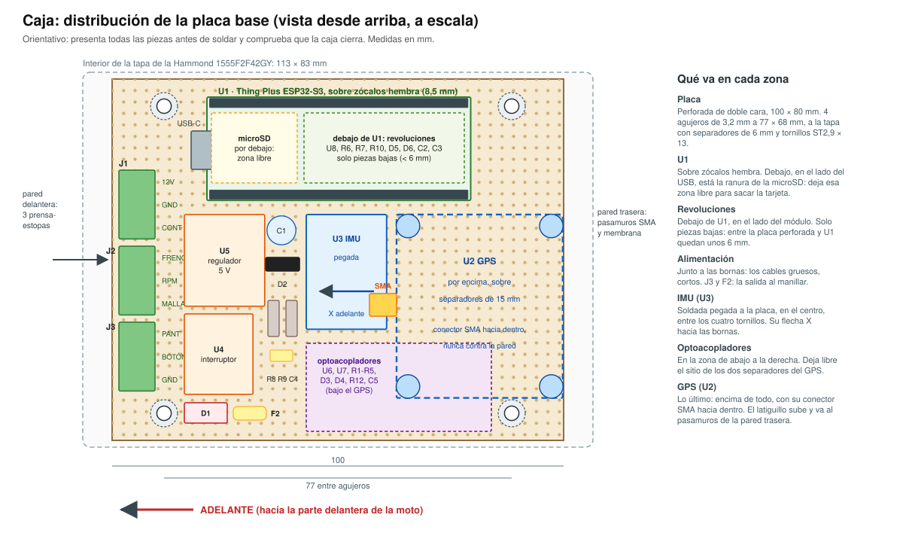
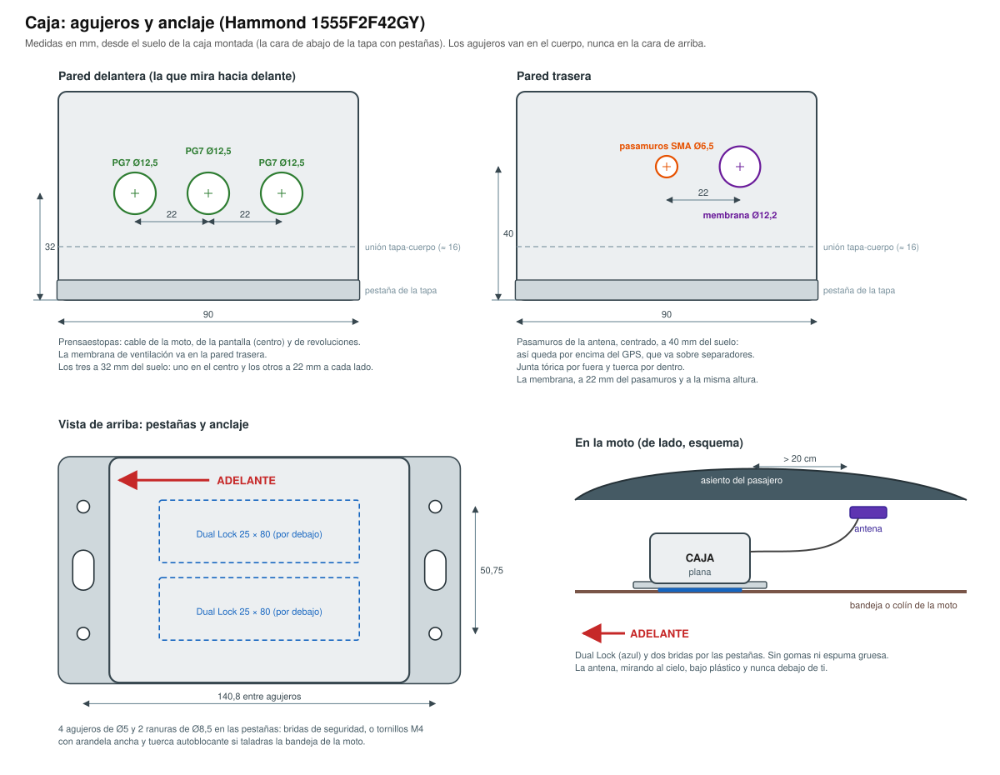
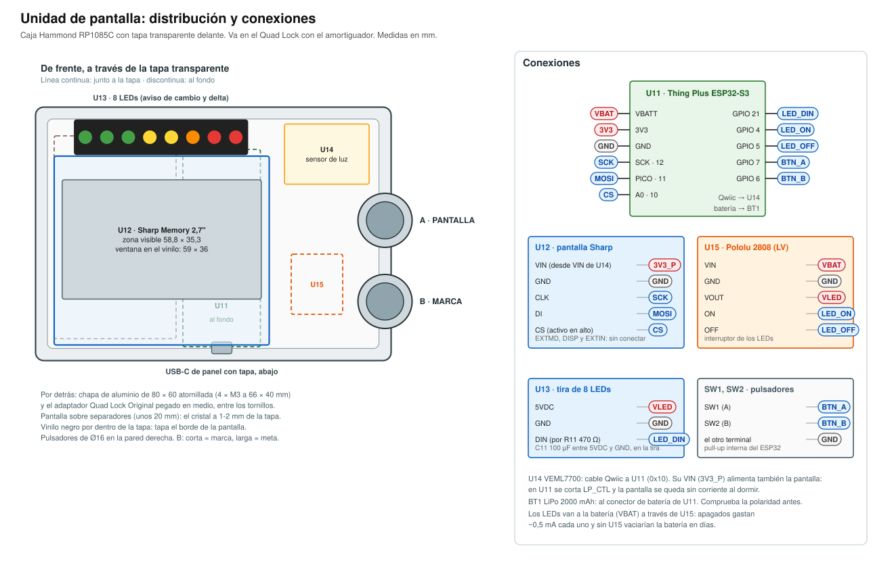

# Montaje paso a paso

Del pedido a la primera salida. Cada parte se prueba antes de pasar a la siguiente: si algo falla, sabes que está en lo último que has hecho. Las piezas están en [piezas.md](piezas.md) y las conexiones en [conexiones.md](conexiones.md).

- [0. Antes de empezar](#0-antes-de-empezar)
- [1. Pruebas de banco, sin soldar](#1-pruebas-de-banco-sin-soldar)
- [2. La placa base](#2-la-placa-base)
- [3. La caja](#3-la-caja)
- [4. El cable de la moto](#4-el-cable-de-la-moto)
- [5. Instalación en la Ninja 125](#5-instalación-en-la-ninja-125)
- [6. Freno y revoluciones (fase 2)](#6-freno-y-revoluciones-fase-2)
- [7. Unidad de pantalla (fase 4)](#7-unidad-de-pantalla-fase-4)
- [8. Comprobaciones antes de rodar](#8-comprobaciones-antes-de-rodar)
- [9. Mantenimiento](#9-mantenimiento)

Tiempo aproximado, sin contar esperas:
- pruebas de banco: 1 tarde;
- placa base: 2-3 tardes;
- caja y cable: 1 tarde;
- instalación en la moto: 1 mañana;
- revoluciones: 2 h;
- pantalla: 2-3 tardes, más lo que tarde la impresión de la carcasa.

---

## 0. Antes de empezar

### 0.1 El pedido

Va en dos partes.

1. **Ahora, la caja y el material de instalación** (apartados 1 y 3 de [piezas.md](piezas.md), ≈ 360 €):
   - un pedido en DigiKey con todo lo que lleve referencia de DigiKey;
   - en Amazon o en una tienda, la microSD y el material genérico.
2. **Más adelante, la pantalla** (apartado 2, ≈ 207 €):
   - en RS, la Riverdi y su Break Out Board 20;
   - en DigiKey, la placa, el regulador y los componentes;
   - en Kiwi, los LEDs y el sensor de luz;
   - en BricoGeek, los pulsadores;
   - en Quad Lock, el adaptador;
   - en Amazon, el conector SP13 y los insertos.

### 0.2 Busca el sitio en la moto

La caja mide **160,8 × 90,8 × 62,5 mm** contando las pestañas.

1. **Haz una maqueta de cartón** de ese tamaño.
2. **Pruébala debajo de los asientos.** Busca, en este orden:
   1. **bajo el asiento del pasajero**: atrás, lejos del calor del motor;
   2. **junto a la batería**, bajo el asiento del piloto;
   3. **en el colín**, sobre el guardabarros.
3. **Comprueba estas cuatro cosas en el sitio que elijas:**
   - la caja queda **plana** y con el lado largo a lo largo de la moto;
   - **el asiento cierra** sin apretarla;
   - está **lejos del escape** y de cualquier pieza que se mueva;
   - hay una superficie plana y limpia para pegarla, o un tubo del chasis o un soporte cerca para las bridas;
   - para el soporte impreso ([impresion.md](impresion.md)): fotos del hueco desde arriba y de lado, con una regla al lado, y dónde hay tornillos, pestañas o tubos de la moto a los que agarrarlo.
4. **Busca también el sitio de la antena** (50 × 38 × 17 mm):
   - mirando al cielo, bajo plástico (el asiento del pasajero o el colín), nunca bajo metal;
   - a **más de 20 cm de la caja**: la radio de la placa mete ruido al GPS;
   - **que no quede debajo de ti**: el cuerpo tapa la señal.
5. **Si no cabe en ninguno**, para aquí y dímelo con las medidas del hueco: cambiamos a una caja más estrecha (Hammond 1555C2F42GY, 120 × 66 mm) y rehago la placa.

### 0.3 Normas de seguridad

1. **Desconecta el negativo de la batería** antes de empalmar nada en la moto.
2. **No cortes ningún cable de la moto**: solo derivaciones (Posi-Tap) o terminales bajo un tornillo que ya existe.
3. **El fusible, a menos de 15 cm de la batería.**
4. **Nada cerca del escape, del radiador, de la cadena ni de la dirección.**
5. **Con el manillar girado a tope a cada lado**, ningún cable tira ni se pilla.
6. **Después de cada cambio, comprueba:** luz de posición, luz de freno con la maneta y con el pedal, intermitentes, claxon y arranque.
7. **Al soldar:** gafas, ventilación y el soldador siempre en su soporte.

---

## 1. Pruebas de banco, sin soldar

Antes de soldar nada, comprueba que cada pieza funciona. Es el hito **H1** del plan:
- todo se conecta con cables Qwiic, que son de enchufar;
- el programa de prueba se instala desde una página web, sin instalar nada en el Mac.

Necesitas:
- la placa U1 (Thing Plus);
- el GPS U2 con su antena;
- el sensor U3;
- la microSD y los dos cables Qwiic;
- un cable USB-C de datos;
- el Mac con **Chrome**.

### 1.1 Prepara la microSD

1. Métela en el Mac, con un adaptador si hace falta.
2. Abre **Utilidad de Discos**, elige la tarjeta y pulsa **Borrar**:
   - formato «MS-DOS (FAT)», que es FAT32;
   - esquema «Registro de arranque maestro».
3. Expúlsala y métela en la ranura de la placa U1.

### 1.2 Conecta las piezas

```
 Mac ══(USB-C)══ U1 placa ──(Qwiic)── U2 GPS ──(Qwiic)── U3 sensor
                                         │
                                       antena
```

1. Enrosca la antena en el conector SMA del GPS, a mano.
2. Une la placa U1 y el GPS con un cable Qwiic.
   - Los conectores Qwiic son los pequeños, negros, de 4 patillas.
   - Solo entran en un sentido: no fuerces.
3. Une el GPS y el sensor con el otro cable Qwiic: van en cadena.
4. Deja el sensor plano sobre la mesa. La antena, junto a una ventana o, mejor, fuera.

### 1.3 Instala el programa de prueba

1. Abre **Chrome** en el Mac. Safari no sirve: no puede hablar con la placa.
2. Entra en la página de la caja: <https://pepe-a-d.github.io/streetchaos/caja/>. Si quieres verla antes de tener la placa, añade `?demo` al final de la dirección.
3. Conecta la placa U1 al Mac con el cable USB-C.
4. Pulsa **INSTALAR LA PRUEBA** y elige en la lista el puerto de la placa.
5. Espera a que termine.

**Si no sale ningún puerto, o la instalación falla:**
1. mantén pulsado el botón **BOOT** de la placa;
2. pulsa y suelta **RESET**;
3. suelta BOOT y vuelve a probar.

Si aun así no sale, prueba con otro cable USB-C: algunos solo cargan y no pasan datos.

### 1.4 Lee los resultados

La misma página dice **OK** o **FALLA** para cada pieza:

| Pieza | Qué comprueba | Qué tienes que ver |
| --- | --- | --- |
| MICROSD | El tipo y el tamaño de la tarjeta; escribe un archivo, lo vuelve a leer y mide la velocidad | OK, unos 32 GB y su velocidad en MB/s |
| GPS | Que responde por el Qwiic y es un NEO-M9N; los satélites y la posición | Pone **BUSCANDO** hasta que la antena ve el cielo, y luego OK. Con la antena fuera, posición en menos de un minuto y con más de 8 satélites. El LED `PPS` del GPS parpadea una vez por segundo cuando tiene posición |
| SENSOR | Que responde (dirección 0x6A). En la mesa, el eje Z marca unos +9,8 y los giros, casi 0 | OK en reposo. Luego pone **INCLINALO**: inclínalo más de 30° y vuelve a OK |

El LED de la placa U1 también lo dice: **azul** mientras prueba, **verde** si todo está bien y **rojo** si algo falla.

**Si todo da OK, el material está bien** y puedes pasar a soldar la placa base (apartado 2). Mándame una captura de la página.

Si algo da FALLA, mándame una captura de la página y una foto de cómo está conectado.

---

## 2. La placa base



### 2.1 Cortar y agujerear

1. **Corta la placa perforada a 100 × 80 mm.** Raya por las dos caras con el cuchillo y la regla, siguiendo una fila de agujeros, y pártela sobre el borde de la mesa. Lija el canto.
2. **Haz 4 agujeros de 3,2 mm** para sujetarla a la tapa de la caja. Van a 11,5 mm de los lados cortos y a 6 mm de los largos: 77 mm entre ellos a lo largo y 68 mm a lo ancho. Coinciden con 4 de los 6 agujeros que trae la tapa por dentro.
3. **Preséntala en la tapa** con los separadores de 6 mm y comprueba que encaja sin tocar las columnas de las esquinas.

### 2.2 Presentar antes de soldar

Coloca todas las piezas sobre la placa según el [dibujo](esquemas/placa-base.svg), sin soldar, y comprueba:

- **El GPS va sobre separadores de 15 mm**, por encima de las demás piezas, con su **conector SMA hacia dentro** de la placa, nunca contra la pared. El latiguillo tiene que poder ir del conector al pasamuros sin doblarse en seco.
- **El sensor de movimiento (U3)** va en el centro, entre los cuatro tornillos, que es donde menos vibra la placa. Su flecha X apunta hacia el lado de las bornas (será «adelante» en la moto).
- **Las bornas J1 y J2**, en el lado corto de la izquierda, que es donde entrarán los cables.
- **El USB-C de la placa U1** queda accesible al quitar la tapa.

Marca la posición de cada pieza con un rotulador.

### 2.3 Zócalos de la placa U1

1. **Suelda las tiras de pines macho a U1** (la Thing Plus), con los pines hacia abajo.
2. **Los zócalos hembra, usando la propia U1 de plantilla:**
   - pincha los zócalos en sus pines y pon el conjunto sobre la placa perforada, en su sitio;
   - suelda una patilla de cada esquina y comprueba que todo queda recto;
   - suelda el resto.
3. **Saca U1** y déjala aparte hasta la prueba 2.6.

### 2.4 Alimentación

Suelda estas piezas:
- J1, D1 y C1;
- U4 y U5, sobre pines macho;
- D2, R3, R8, R9 y C4;
- F2 y J3, la salida al manillar (pantalla o botón).

Después une con hilo, por la cara de abajo, estas redes de la [lista de conexiones](conexiones.md#4-lista-de-conexiones-de-la-placa-base):
- `12V`, `GND`, `ON` y `12V_SW`;
- `CONT`, por ahora solo J1-3 y R3;
- `5V_REG`, `5V`, `VMOTO` y `PANT`.

Fíjate en el sentido de tres piezas:

| Pieza | Sentido |
| --- | --- |
| D1 (TVS) | La raya va a `12V` |
| D2 | La raya va a `5V` |
| C1 | La pata corta (−) va a `GND` |

**Prueba 1**, con la fuente de 12 V y sin U1 ni el GPS:

1. **Comprueba con el multímetro:**
   - en continuidad, **no tiene que pitar** entre `12V` y `GND`, ni entre `5V` y `GND`. Un pitido corto al principio es un condensador cargándose: normal;
   - en modo diodo, con la punta roja en `12V` y la negra en `GND`, tiene que marcar «OL». Si marca ~0,6 V, D1 está al revés.
2. Conecta la fuente a J1-1 (+) y J1-2 (−).
   - En `12V_SW` (la salida de U4) tiene que haber **0 V**: el interruptor está apagado.
3. Une con un cable **J1-3 a J1-1** para simular el contacto.
   - `12V_SW` ≈ 12 V.
   - `5V_REG` = 5,0 V.
   - `5V` ≈ 4,7-4,9 V.
   - `VMOTO` ≈ 2,2 V.
   - `PANT` (J3-1) ≈ 12 V.
4. **Quita ese cable**: todo tiene que seguir encendido, porque el interruptor se queda enclavado.
5. Toca un instante la patilla `OFF` de U4 con un cable que venga de `5V`: **todo se apaga** (0 V).

Si algo no sale, no sigas: repasa esa parte.

### 2.5 Entradas

- **Contacto y freno:** U6, U7, R1, R2, R4, R5, D3 y D4.
- **Revoluciones:** U8, R6, R7, R10, D5, D6, C2 y C3, y J2.
- **Botón del manillar:** R12 y C5 (redes `BTN_MAN` y `BTN`). Solo se usa con el móvil de pantalla, pero se sueldan ya: son dos piezas.
- **Patillas sin usar del 74HC14:** une a `GND` las entradas 3, 5, 9, 11 y 13. Es importante: al aire, el chip hace cosas raras.

### 2.6 Prueba de las entradas

1. Pincha U1 en sus zócalos y conéctala al Mac por USB: se alimenta por ahí.
   - Mide los puntos `IGN` (patilla 6) y `BRK` (patilla 7): **3,3 V** los dos.
2. Conecta además la fuente de 12 V y une J1-3 a J1-1.
   - `IGN` baja a **menos de 0,4 V**.
3. Une J2-1 a J1-1.
   - `BRK` baja a menos de 0,4 V.
4. Toca J2-2 con un cable que venga de `3V3`.
   - Mide en la patilla `1` de U1 (la patilla 2 de U8 queda debajo de la placa): pasa de 3,3 V a 0 V. Al soltar, vuelve a 3,3 V.
5. Con la fuente quitada y el multímetro en ohmios, mide entre J3-2 y la patilla `A1` de U1: unos 1 kΩ (es R12). El botón se prueba de verdad en la prueba de la caja (paso 2.9).

### 2.7 El sensor de movimiento

1. Suelda las dos tiras de pines al sensor (U3): la de 9 abajo y la de 5 arriba.
2. **Suéldalo a la placa pegado a ella**, con la base de plástico de los pines apoyada.
   - Que no quede en el aire: cuanto más rígido, mejores las medidas.
   - La fila de 5 pines no lleva conexiones; solo sujeta.
3. Une `3V3`, `GND`, `SDA`, `SCL` e `INT1`.

### 2.8 El GPS

1. Pon los 4 separadores de 15 mm.
2. Prepara 5 hilos de silicona de unos 8 cm.
3. Suéldalos directamente en los agujeros del GPS:
   - `5V`, `GND`, `TX` y `RX` en la fila de arriba;
   - `PPS` en la fila de abajo.
4. Suelda el otro extremo de cada hilo a su red de la placa:
   - `TX` del GPS a `RX` de U1;
   - `RX` del GPS a `TX` de U1.
5. Atornilla el GPS a los separadores.

Nada de cables Dupont dentro de la caja: con las vibraciones se sueltan.

### 2.9 Repaso final

1. **Repasa la lista de conexiones entera con el multímetro**, red por red.
2. **Comprueba que no hay cortos** entre `12V`, `5V`, `3V3` y `GND`.
3. **Mira las soldaduras con la lupa o el móvil.**
   - Tienen que ser brillantes y en forma de cono.
   - Ni bolas ni puentes entre agujeros vecinos.
4. **Prueba de la caja**, con el firmware de la caja (desde el hito H2):
   1. Con la fuente de 12 V **quitada**, conecta la placa U1 al Mac por USB.
   2. En la página del paso 1.3, pulsa **INSTALAR LA CAJA**. Al terminar, la página lee la placa por el USB y enseña **PRUEBA DE LA CAJA**:
      - MICROSD: OK;
      - GPS: OK. Ahora va por sus patillas `TX` y `RX`, no por el Qwiic, y la página comprueba también que llega la PPS;
      - SENSOR: OK.
      - La contraseña de la red WiFi de la caja: **apúntala** en una pegatina por dentro de la tapa. La inventa la caja la primera vez que arranca y no está en ningún otro sitio. Si la pierdes, vuelve a salir al pasar la prueba por USB.
   3. **Sin quitar el USB**, conecta la fuente: + a J1-1 y − a J1-2. El USB va siempre antes que la fuente, nunca con la caja ya encendida ([conexiones, apartado 2](conexiones.md#2-alimentación-de-la-caja)).
      - Une J1-3 a J1-1: CONTACTO, OK.
      - Une J2-1 a J1-1: FRENO, OK.
      - BATERÍA DE LA MOTO enseña una tensión: tiene que salir parecida (±0,3 V) a la que mide el multímetro en J1-1.
      - REVOLUCIONES marca 0 en la mesa: es lo normal.
      - Une un momento J3-2 a J3-3: BOTÓN, OK.
      - **En el prototipo simple** (sin freno, revoluciones ni J3), la página dice «PROTOTIPO SIMPLE: SIN FRENO, REVOLUCIONES NI BOTON» y no prueba esas tres cosas.
5. **Prueba de apagado**, antes de llevarla a la moto. Con el firmware de la caja (desde el hito H2):
   - con J1-3 unido a J1-1 (el contacto), la caja se enciende;
   - quita ese cable: en **menos de 1 minuto** se apaga sola. Sin el USB, el LED de U1 se apaga y en `5V` y en J3-1 hay 0 V. Con el USB puesto, la placa sigue encendida por el USB y la página dice «APAGADO PEDIDO»; comprueba entonces que en `12V_SW` hay 0 V;
   - comprueba que apagada no gasta nada: quita el cable de la fuente de J1-1 y pon el multímetro en corriente continua (escala de mA) entre el + de la fuente y J1-1. Tiene que marcar **0** (unos µA como mucho).
   - Si no se apaga o gasta algo, no la montes en la moto: dímelo.

---

## 3. La caja



La **tapa** de la Hammond 1555F2F42GY es la que lleva las pestañas: es la base, la que se sujeta a la moto, y la placa va atornillada en ella. El **cuerpo** es la tapa de arriba y se quita con 4 tornillos.

### 3.1 Agujeros en el cuerpo

Medidas en el [dibujo](esquemas/caja-taladros.svg). Taladra despacio con la broca escalonada y quita las rebabas.

| Dónde | Agujero | Para |
| --- | --- | --- |
| Pared corta delantera, a 32 mm del suelo de la caja montada: en el centro y a 22 mm a cada lado | 3 × Ø 12,5 mm | Prensaestopas PG7: a los lados, cable de la moto y cable de revoluciones; en el centro, cable de la pantalla |
| Pared corta trasera, en el centro, a 40 mm del suelo | Ø 6,5 mm (compruébalo con el pasamuros) | Pasamuros SMA de la antena |
| Pared corta trasera, a 40 mm del suelo y a 22 mm del pasamuros | Ø 12,2 mm | Membrana de ventilación |

El «suelo» es la cara de abajo de la tapa con pestañas.

A esas alturas los agujeros quedan en el cuerpo, por encima de la unión con la tapa (a unos 16 mm del suelo; mídela en tu caja). El pasamuros y la membrana van más altos que los prensaestopas, para pasar por encima del GPS.

**Nunca en la cara de arriba**: el agua se queda encima.

### 3.2 Montar los pasacables

1. **Prensaestopas:** con la tuerca por dentro.
2. **Pasamuros SMA:** la junta tórica por fuera y la tuerca por dentro.
3. **Membrana de ventilación:** con su tuerca por dentro.

Apriétalos firmes, pero sin pasarte: el policarbonato se agrieta.

### 3.3 La placa en la tapa

1. Atornilla la placa base a la tapa: 4 tornillos ST2,9 × 13, cada uno con su separador de 6 mm.
2. Conecta el latiguillo del conector SMA del GPS al pasamuros. A mano, más 1/8 de vuelta.
3. Mete la microSD.

### 3.4 Rotular

En la cara de arriba del cuerpo, con rotulador permanente o una pegatina:
- una **flecha «ADELANTE»** hacia la pared de los prensaestopas;
- **«FUSIBLE 2 A»**.

La caja se cierra después de conectar el cable de la moto (paso 4.7).

---

## 4. El cable de la moto

Se prepara en la mesa, menos las dos derivaciones del piloto trasero.

1. **Mide con un cordel** el recorrido sobre la moto:
   - de la caja a la batería;
   - de la caja al conector del piloto trasero.
   - Añade 15 cm a cada uno.
2. **Corta la manguera de 4 hilos** a la medida más larga.
   - En el punto donde se separan los dos caminos, quita la funda exterior.
   - Cubre la bifurcación con termorretráctil con adhesivo.
   - **Marrón y blanco** van a la batería; **verde y amarillo** al piloto.
3. **Batería:**
   - **Marrón:** empalma a tope uno de los cables del portafusibles. Crimpa y pon termorretráctil con adhesivo encima. En el otro cable del portafusibles, crimpa un terminal de ojal M5.
   - **Blanco:** crimpa directamente un terminal de ojal M5.
   - **No pongas aún el fusible.**
4. **Cable de revoluciones (LiYCY):**
   - **Extremo de la caja:** el hilo blanco a J2-2 y la malla, retorcida, a J2-3. El hilo marrón no se usa: córtalo y aíslalo.
   - **Extremo de la bobina:**
     - quita 40 cm de funda y de malla: dan para unas 13 vueltas, por si en la calibración hacen falta más de 10;
     - corta la malla al ras y aíslala con termorretráctil;
     - el marrón, cortado y aislado;
     - el blanco queda suelto para enrollarlo en la moto (paso 6). Su punta, aislada con un capuchón de termorretráctil.
5. **Resistencias de las derivaciones (RT1 y RT2):**
   - en el extremo del **verde**, a 2-3 cm de la punta, intercala RT1 (1 kΩ ½ W): corta el cable, suelda la resistencia entre los dos trozos y cúbrela con termorretráctil con adhesivo;
   - lo mismo con RT2 en el **amarillo**;
   - la punta corta que queda es la que irá a la Posi-Tap;
   - con el multímetro, entre esa punta y el otro extremo del cable, tiene que marcar unos 1 kΩ.

   Son el seguro de esos dos cables: si se pelan y tocan masa bajo el asiento, no salta el fusible de las luces de la moto.
6. **Mete los dos cables por los prensaestopas** y conecta en J1 y J2 según la tabla de [conexiones.md](conexiones.md#5-cable-de-la-caja-a-la-moto-ninja-125).
   - Deja 10 cm de holgura dentro, para poder levantar el cuerpo de la caja.
   - Aprieta los prensaestopas.
   - Tira un poco de cada cable: no tiene que moverse.
   - **El prensaestopas del centro es para el cable al manillar** (fase 4: la pantalla o el botón del manillar). Hasta entonces, tápalo: mete un trozo de 3 cm de cable de 5-6 mm (vale un recorte de la manguera) y apriétalo.
7. **Cierra la caja:**
   - comprueba que la junta de silicona está bien asentada en su ranura;
   - aprieta los 4 tornillos M4 en cruz, con poca fuerza: el fabricante dice 30 cN·m, que es justo «firme» a mano con un destornillador pequeño.

---

## 5. Instalación en la Ninja 125

### 5.1 Identificar los cables del piloto trasero

Con la batería **conectada** todavía:

1. Quita los asientos y busca el conector del piloto trasero.
   - Suele estar bajo el colín.
   - Tiene 3 cables: posición, freno y masa.
2. Pon el multímetro en tensión continua (20 V) y la punta negra en el **borne − de la batería**.
3. Da el contacto, sin arrancar.
4. Con la punta roja, toca cada cable por detrás del conector: mete la punta junto al cable por la goma, sin pinchar el cable.

| Lo que mides | Qué cable es |
| --- | --- |
| ~12 V con el contacto, sin tocar nada | **Posición** → irá al **verde** (`CONT`) |
| 0 V, y ~12 V solo mientras alguien tira de la maneta o pisa el pedal | **Freno** → irá al **amarillo** (`FRENO`) |
| 0 V siempre | Masa (confírmala en continuidad con el borne − de la batería, con el contacto quitado) |

5. Apunta los colores de cada uno.
6. Quita el contacto: los tres tienen que dar 0 V. Con un piloto de LED puede verse alguna tensión «fantasma» de pocos voltios: lo que cuenta es la diferencia clara entre encendido y apagado.
7. **Si tu llave tiene posición P** (estacionamiento), ponla en P y mide la posición.
   - **Si tiene 12 V:** la caja no se apagaría nunca en P. O no aparcas en P, o tomas el contacto de otro cable que solo tenga 12 V en ON, como la alimentación del interruptor de la luz de freno (en el conector de la maneta delantera).
8. Mide el grosor de los cables de posición y freno para comprar la Posi-Tap de su talla.

**Si la luz de posición no se enciende con el contacto** (no debería pasar en una moto de 2019 o posterior), busca otro cable que tenga 12 V solo con el contacto, por ejemplo el de la luz de matrícula. Mídelo igual.

### 5.2 Desconectar la batería

Quita primero el cable del borne **−** y apártalo para que no toque nada.

### 5.3 Fijar la caja

En el sitio elegido en el paso 0.2:

1. **Limpia con alcohol** la cara de abajo de la tapa y la superficie de la moto.
2. **Pega dos tiras de Dual Lock de 25 × 80 mm** en la caja y sus compañeras en la moto.
   - Presenta la caja: plana y con la flecha **ADELANTE** hacia delante.
   - Aprieta fuerte 30 segundos.
3. **Pon dos bridas por los agujeros de las pestañas** que abracen un tubo del chasis o un soporte.
   - **Lo que sujeta de verdad son las bridas, o los tornillos de la alternativa de abajo.** El Dual Lock asienta la caja y quita holguras.
   - Las bandejas de debajo del asiento suelen ser de polipropileno (por detrás pone «PP»), donde el adhesivo pega mal. Si es tu caso, dale antes una mano de imprimación (3M Primer 94) o usa los tornillos.
4. Deja que el adhesivo coja fuerza: **24 h antes de rodar**.

**Alternativa, si no te importa taladrar la bandeja de plástico:**
- 2 tornillos M4 por los agujeros de las pestañas;
- arandelas anchas por debajo;
- tuercas autoblocantes.

Es lo más firme. Nunca la sujetes con gomas ni con espuma gruesa: si la caja baila, la inclinación y las G salen mal.

### 5.4 La antena

1. **Pégala en el sitio elegido** con Dual Lock o cinta de doble cara.
   - **La base del imán va abajo** y la cara de arriba mira al cielo.
   - Si va sobre plástico, ponle debajo una chapita de acero de unos 7 × 7 cm: el imán se agarra a ella y hace de plano de masa, lo que mejora la recepción.
2. **Lleva el cable hasta la caja**:
   - recoge lo que sobra en una vuelta floja (más de 5 cm de diámetro) y sujétala con bridas, sin apretar;
   - que el asiento no lo pise;
   - que no tenga dobleces en seco.
3. **Enróscalo en el pasamuros**, a mano.

### 5.5 Pasar los cables

1. Lleva la manguera por dentro del tubo corrugado, junto al mazo de cables de la moto.
2. Pon una brida cada 10-15 cm.
3. Comprueba que no roza con nada que se mueva ni toca el escape.

El cable de la pantalla irá por el mismo camino hasta la pipa de dirección (paso 7.5).

### 5.6 Batería

1. Pon el **ojal del portafusibles (marrón)** en el borne **+**, junto al cable de la moto.
2. Pon el **ojal blanco** en el borne **−**, también junto al cable de la moto.
3. Aprieta los dos tornillos.
4. Sujeta el portafusibles con una brida, a menos de 15 cm de la batería.

### 5.7 Derivaciones del piloto trasero

1. **Verde → cable de posición** con una Posi-Tap:
   1. el cuerpo se pone sobre el cable de la moto;
   2. se enrosca el tapón con el cable verde;
   3. se aprieta a mano.
2. **Amarillo → cable de freno** con la otra.
3. Ponlas donde no les caiga agua directamente y cúbrelas con cinta autovulcanizante.
4. Tira suave de cada cable para comprobar que aguanta.

### 5.8 Conectar y probar

1. **Conecta el borne −** de la batería.
2. **Pon el fusible de 2 A.**
3. **Prueba la moto**:
   - posición encendida con el contacto;
   - freno con la maneta;
   - freno con el pedal;
   - intermitentes;
   - claxon;
   - arranque.
4. **Prueba la caja:** da el contacto unos minutos, quítalo y espera 2 minutos. La caja se apaga sola en menos de 1 minuto. El LED no se ve, porque la caja es opaca. Desde el hito H5, su red WiFi «StreetChaos-Caja» aparece con la moto parada y sin grabar:
   - con el contacto puesto, antes de salir;
   - al aparcar, mientras espera al móvil (hasta 10 minutos, 15 como mucho).
5. **Comprueba que apagada no gasta nada** (en la moto, la única prueba de que se corta sola de verdad):
   1. espera a que se apague, con el contacto quitado;
   2. quita el fusible de 2 A;
   3. pon el multímetro en corriente continua (escala de mA) con las puntas en los dos contactos del portafusibles.
   - Tiene que marcar **0** (unos µA como mucho).
   - Si marca decenas de mA, la caja no se ha apagado: deja el fusible quitado y dímelo.
   - Si marca 0, pon otra vez el fusible.

   > **Si algún día, con la moto aparcada más de 20 minutos, la caja sigue encendida** (esta medida no da 0 o, desde H5, su red WiFi sigue ahí), quita el fusible y dímelo. Encendida gasta unos 0,1-0,3 A y vaciaría la batería de la moto en uno o dos días.
6. **Gira el manillar a tope** a los dos lados: nada tira.
7. **Pon los asientos**: cierran sin pillar ningún cable.

---

## 6. Freno y revoluciones (fase 2)

### 6.1 El freno

No hay nada que montar: la derivación va desde el paso 5.7 y la caja apunta el freno desde la primera salida (hito H3).

- Desde el hito H5: con el contacto puesto y la moto parada, conecta el móvil a la red «StreetChaos-Caja» y abre la pestaña **TALLER** de su página. FRENO tiene que encenderse al tirar de la maneta y al pisar el pedal, y apagarse al soltar. Más adelante se verá también en la pantalla ESTADO.
- Con el Blackbox del hito H6, el freno sale en FRENADAS.
- Si no aparece nunca, revisa la derivación del amarillo (paso 5.7).

### 6.2 Llegar al cable de bujía

1. **Busca la bobina:**
   - en la Ninja 125 va sujeta al chasis con dos tornillos;
   - de ella sale el cable de bujía hasta una pipa larga en la culata;
   - según dónde quede, puede que haya que quitar el carenado lateral o la tapa del depósito (mira el manual de taller o un vídeo de tu modelo).
2. **Nunca arranques el motor con la pipa quitada**: el pico de tensión puede romper la bobina o la centralita.

### 6.3 Pasar el cable

1. Lleva el cable apantallado de la caja a la bobina **por el chasis**:
   - dentro del tubo corrugado;
   - lejos del escape, del ventilador del radiador y de la dirección;
   - con una brida cada 10-15 cm.
2. **No lo pongas pegado a otros cables en paralelo** si puedes evitarlo.

### 6.4 Enrollar la pinza

1. A unos **5 cm de la bobina**, enrolla el hilo blanco **8-10 vueltas** apretadas sobre el cable de bujía, una junto a otra.
2. Sujétalo con cinta autovulcanizante.
3. Cubre el tramo que queda cerca del motor con la **funda de fibra de vidrio**: el aislante normal no aguanta el calor de la culata.

### 6.5 Calibrar

Con la moto parada, en punto muerto y con el motor en marcha: conecta el móvil a la red «StreetChaos-Caja» y abre la pestaña **TALLER** de su página.

1. **Motor al ralentí**, ya caliente. Compara las REVOLUCIONES de TALLER con el cuentarrevoluciones de la moto.
2. **Ajusta las chispas por vuelta** en TALLER, empezando por una chispa por vuelta:
   - si marca lo mismo que el cuentarrevoluciones, se queda en **1 chispa por vuelta**;
   - si marca **la mitad**, es una chispa cada dos vueltas: elige ese ajuste;
   - si marca **el doble**, está contando dos pulsos por chispa: quita una vuelta a la pinza, o dime que alargue la ventana de rebote del firmware.
3. **Comprueba a unas 5000 rpm sostenidas.** Tiene que cuadrar a ±50 rpm.
   - TALLER guarda el ralentí.
   - Apúntame el ajuste de chispas que ha quedado y el ralentí: son datos de tu moto.
4. **Si no cuenta o cuenta a saltos**, ajusta según [conexiones.md, apartado 3.2](conexiones.md#32-revoluciones-pinza-en-el-cable-de-bujía): 2-3 vueltas más (o quitar C2, sacando antes U1) si no cuenta, y una vuelta menos si cuenta de más.

---

## 7. Unidad de pantalla (fase 4)



Va en tu soporte Quad Lock, con el amortiguador de vibraciones entre medias.
- Es una pantalla de 4,3" en color que se ve al sol y de noche, en una carcasa impresa en ASA.
- No lleva batería: toma la corriente de la caja por un cable, y se enciende y se apaga con ella.
- Para quitarla del soporte, se desenchufa el conector estanco.

### 7.1 Distribución

La carcasa mide unos 116 × 98 × 36 mm por fuera ([impresion.md](impresion.md), pieza 7):

1. **Delante, la pantalla.** Va atornillada por sus 4 orejetas a insertos M3 y asoma por un marco con junta de TPU. No lleva cristal delante: un cristal añade reflejos al sol.
2. **Encima de la pantalla, la tira de LEDs**, tras una ventana de policarbonato.
3. **En la pared de arriba, el sensor de luz**, tras una ventanita, mirando al cielo.
4. **En la pared derecha, por detrás de la pantalla, los dos pulsadores:** A arriba y B abajo.
5. **Detrás de la pantalla:**
   - la Break Out Board 20;
   - una placa perforada con U11, U16, U17 y los componentes de la alimentación.
6. **En la pared de abajo, el prensaestopas del cable**, con unos 15 cm de cable hasta el conector SP13 macho.
7. **Por detrás, la chapa de aluminio** atornillada a insertos, con el adaptador Quad Lock pegado.

Antes de imprimir la definitiva, imprime la carcasa en PLA y presenta todas las piezas:
- la pantalla asienta en su marco;
- los pulsadores no chocan con nada;
- la tapa cierra.

### 7.2 La placa de la pantalla

En una placa perforada de unos 50 × 70 mm, como la placa base de la caja (apartado 2):

1. **Zócalos hembra para U11**, soldados usando la propia placa de plantilla (como en el paso 2.3).
2. **La alimentación:** D11, C12, U16 (sobre pines macho) y D12. Fíjate en el sentido:

   | Pieza | Sentido |
   | --- | --- |
   | D11 (TVS) | La raya va a `PANT_IN` |
   | D12 | La raya va a `VUSB` |
   | C12 | La pata corta (−) va a `GND` |

3. **U17** (74AHCT125), con C13 pegado a sus patillas 7 y 14. La patilla 1 lleva un punto o una muesca.
4. **Une las redes** de [conexiones, apartado 6.3](conexiones.md#63-redes-para-soldar) con hilo por debajo.
   - Hasta los pines de la Break Out Board 20, hilos de silicona.
   - R11 va en el hilo de datos de los LEDs, junto a la tira, cubierta con termorretráctil.
   - C11 va soldado en las patillas de alimentación de la tira.

**Prueba de la placa**, sin U11 y sin la pantalla:
1. Con el multímetro en continuidad, **no tiene que pitar** entre `PANT_IN` y `GND`, ni entre `5V_P` y `GND`.
2. Conecta la fuente de 12 V a un SP13 (patilla 1 al +, 2 al −):
   - en `5V_P` tiene que haber 5,0 V;
   - en `VUSB`, unos 4,7-4,9 V.

**Prueba con la pantalla:**
1. Pincha U11 en sus zócalos.
2. Une la Break Out Board 20 y la pantalla **con el cable plano que trae la Break Out Board**, sin forzar los cierres de los conectores. Conecta también la tira de LEDs, el sensor de luz (cable Qwiic) y los dos pulsadores, aunque estén sueltos.
3. Con la unidad **sin corriente**, conecta U11 al Mac por USB. En la página del paso 1.3, pulsa **INSTALAR LA PANTALLA**.
4. **Sin quitar el USB**, conecta la fuente de 12 V al SP13: patilla 1 al +, patilla 2 al −. El USB va siempre antes que la fuente, nunca con la unidad ya encendida. Solo con el USB la pantalla no se ilumina, porque su luz y los LEDs van a los 5 V del regulador.
5. La página enseña **PRUEBA DE LA PANTALLA**, con OK o FALLA:
   - PANTALLA: el chip de la pantalla contesta y sale una carta de ajuste;
   - LEDS: se encienden uno a uno, en rojo, verde y azul;
   - BOTÓN A y BOTÓN B: púlsalos cuando te lo pida;
   - LUZ: enseña los lux; al tapar el sensor con la mano, bajan.

### 7.3 La carcasa

1. **Imprime la carcasa en ASA** de un color claro, gris o blanco: al sol, una negra pasa de 70 °C, que es el límite de la pantalla. La junta del frente va en TPU ([impresion.md](impresion.md), pieza 7).
2. **Mete los insertos M3** con el soldador a unos 230 °C, empujando recto y sin prisa.
3. **Pantalla:**
   - pon la junta de TPU en el marco;
   - presenta la pantalla y atorníllala por sus 4 orejetas;
   - aprieta poco: la junta queda aplastada, sin doblar el marco.
4. **LEDs y sensor:**
   - pega las ventanas de policarbonato por dentro, con silicona neutra;
   - detrás, la tira de LEDs y el sensor, con cinta de doble cara.
5. **Pulsadores:** en la pared derecha, con su tuerca y su junta.
6. **Placa:** atorníllala a sus insertos y conecta el cable plano.
7. **Cable de salida:**
   - pasa unos 15 cm de manguera por el prensaestopas de abajo (vale un recorte de la de 3 hilos: el verde, cortado y aislado);
   - suelda el marrón a `PANT_IN` y el blanco a `GND`;
   - en la punta, el SP13 macho: patilla 1 marrón, 2 blanco;
   - aprieta el prensaestopas.
8. **Cierra la tapa trasera** con sus tornillos.

### 7.4 La chapa y el Quad Lock

1. **Atornilla la chapa de aluminio** (80 × 60 mm) a la tapa trasera: 4 tornillos M3 a insertos, con arandela de nylon y una gota de silicona neutra en cada uno.
2. **Limpia la chapa con alcohol.**
3. **Pega el adaptador Quad Lock** centrado, entre las cabezas de los tornillos, con su lado largo en vertical, y aprieta 30 segundos.
4. **Espera 24 h** antes de usarlo.

### 7.5 El cable de la caja al manillar

1. **Quita el contacto y desconecta el negativo de la batería** (paso 5.2).
2. **Mide el recorrido**, de la caja al soporte del Quad Lock, con el manillar girado a tope hacia el lado más lejano. Añade 20 cm.
3. **Abre la caja** (4 tornillos) y quita el trozo de cable que tapaba el prensaestopas del centro.
4. **Pasa la manguera de 3 hilos** por el prensaestopas del centro:
   - marrón a J3-1 (`PANT`), verde a J3-2 (`BOTÓN`) y blanco a J3-3 (`GND`);
   - aprieta el prensaestopas y cierra la caja (paso 4.7).
5. **Lleva el cable por el chasis**, junto al mazo de la moto y dentro del tubo corrugado, hasta la pipa de dirección.
   - De ahí sube al manillar por donde van los cables de las piñas.
   - Deja una vuelta floja para que la dirección gire sin tirar.
6. **En la punta, el SP13 hembra** (patilla 1 marrón, 2 blanco), sujeto con una brida cerca del soporte. El verde, cortado y aislado con termorretráctil: es del botón del manillar, que con la Riverdi no se usa.
7. **Conecta el negativo de la batería** y comprueba con el multímetro en el SP13 hembra:
   - con el contacto quitado y la caja apagada, 0 V;
   - con el contacto, unos 12 V, con la patilla 1 en positivo.
8. **Gira el manillar a tope a los dos lados:** el cable no tira ni se pilla. Comprueba luces y freno.

### 7.6 Probar y poner en la moto

1. **Encaja la pantalla** en el amortiguador del Quad Lock y enchufa el SP13.
2. **Vincúlala con la caja.** Se hace una sola vez; para cambiar de pantalla, se repite.
   1. Con el contacto puesto y la moto parada, la pantalla dice «BUSCANDO LA CAJA».
   2. Conecta el móvil a la red «StreetChaos-Caja» y, en la pestaña **TALLER** de su página, pulsa **VINCULAR PANTALLA**.
   3. Desde entonces, la caja solo habla con esa pantalla.
3. **Con el contacto puesto**, comprueba:
   - la pantalla enseña algo y cambia con el botón A;
   - el botón B marca;
   - los LEDs se encienden;
   - el brillo cambia al tapar el sensor de luz.
4. **Quita el contacto:** la pantalla se queda a oscuras, y se apaga del todo cuando se apaga la caja.
5. **Comprueba** que no tapa el cuadro ni te quita visión, y que el manillar gira a tope sin tocar el carenado.
6. **La unidad pesa unos 250 g:** comprueba que el amortiguador la sujeta firme.
7. **Si ruedas sin la pantalla, tapa el conector** de la moto.

---

## 8. Comprobaciones antes de rodar

- [ ] Luces de posición y freno (maneta y pedal), intermitentes, claxon y arranque, todo igual que antes.
- [ ] La caja se enciende con el contacto y se apaga sola después.
- [ ] El GPS tiene posición con la moto en la calle: en la pestaña TALLER (o en la pantalla ESTADO), satélites y 25 Hz.
- [ ] El freno se marca al frenar (en la pestaña TALLER).
- [ ] Las revoluciones cuadran con el cuentarrevoluciones.
- [ ] Ningún cable tira con el manillar a tope ni toca el escape.
- [ ] El asiento cierra sin pillar nada.
- [ ] La caja no se mueve al empujarla con la mano.
- [ ] La pantalla está bien encajada en el Quad Lock y no se mueve.
- [ ] Primera salida tranquila, con el iPhone grabando también, para comparar en el Blackbox.

---

## 9. Mantenimiento

**Cada mes, o después de lavar la moto, revisa:**
- el fusible y su portafusibles;
- las derivaciones del piloto;
- las bridas;
- los tornillos de la caja.

**Al lavarla:** no apuntes con la hidrolimpiadora a la caja, a la membrana ni a las derivaciones.

**Si la moto va a estar parada meses:** la caja apagada no gasta nada; la batería de la moto se cuida igual que siempre (cargador de mantenimiento si hace falta).

**La microSD:** si un día falla, se cambia y ya. Las salidas ya subidas están en la nube.

**La pantalla:**
- no lleva batería;
- al lavar la moto, no apuntes con agua a presión al conector SP13 ni a los botones;
- aparcada mucho rato a pleno sol en verano, mejor quitarla.
